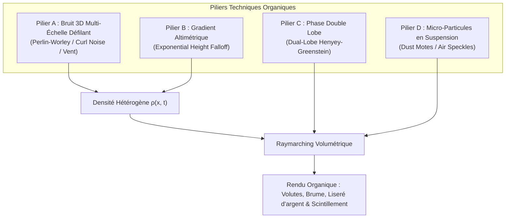

# Analyse Technique : Rendu Organique, Fumée & Texture pour Light Shafts Volumétriques

**Date** : 24 Septembre 2026  
**Auteur** : Antigravity  
**Statut** : 🌫️ Spécification Technique, Étude Comparative & Plan d'Implémentation Quick-Win  
**Fichiers concernés** :
- [`shaders/postfx/volumetric_raymarch_directional.frag`](shaders/postfx/volumetric_raymarch_directional.frag)
- [`src/rendering/volumetric.odin`](src/rendering/volumetric.odin)
- [`src/core/session/session.odin`](src/core/session/session.odin)
- [`src/gui/gui_volumetric.odin`](src/gui/gui_volumetric.odin)
- [`docs/index.md`](docs/index.md)

---

## 1. Contexte & Problématique Visuelle

Dans le moteur, l'éclairage volumétrique directionnel actuel ([`shaders/postfx/volumetric_raymarch_directional.frag`](shaders/postfx/volumetric_raymarch_directional.frag)) repose sur un **milieu homogène** :
- Le coefficient de diffusion $\sigma_s$ (`u_scattering_coeff`) et le coefficient d'extinction $\sigma_t$ (`u_extinction_coeff`) sont constants en tout point de l'espace tridimensionnel.
- La fonction de phase de Henyey-Greenstein est à lobe unique vers l'avant ($g \approx 0.7$).

### Symptôme Visuel
Les rayons crépusculaires (*god rays* ou *light shafts*) apparaissent comme des cônes ou des faisceaux lisses, continus, géométriques et parfaits. Ils manquent de **"caractère"**, de **"matière"**, de **"corps"** et d'imperfections organiques (volutes de fumée, poches de brume denses, filaments d'air turbulents, particules de poussière en suspension).

---

## 2. État de l'Art dans l'Industrie AAA

Les moteurs modernes (*Unreal Engine 5*, *Decima / Horizon Forbidden West*, *Frostbite / Battlefield*, *idTech 7 / Doom Eternal*, *REDengine / Cyberpunk 2077*) modélisent un **milieu hétérogène** régi par l'équation de transfert radiatif :

$$\frac{d L(\mathbf{x}, \omega)}{d s} = -\sigma_t(\mathbf{x}) L(\mathbf{x}, \omega) + \sigma_s(\mathbf{x}) \int_{4\pi} p(\mathbf{x}, \omega', \omega) L_i(\mathbf{x}, \omega') d\omega'$$

Dans ce cadre, la densité locale de particules $\rho(\mathbf{x}, t) \in [0, 1]$ module spatialement les coefficients :
$$\sigma_s(\mathbf{x}, t) = \sigma_{s0} \cdot \rho(\mathbf{x}, t), \quad \sigma_t(\mathbf{x}, t) = \sigma_{t0} \cdot \rho(\mathbf{x}, t)$$

### Les 4 Piliers Techniques AAA pour Injecter de la Matière



---

## 3. Analyse Détaillée des 4 Piliers Visuels

### Pilier A : Bruit 3D Multi-Échelle Défilant (3D Perlin-Worley + Vent)
* **Principe** : Échantillonnage d'une texture 3D tuilable (*seamless*) de $64^3$ ou $128^3$ voxels avec advection temporelle :
  $$\mathbf{u} = \mathbf{x} \cdot s_{\text{noise}} + \mathbf{v}_{\text{wind}} \cdot t$$
  Le bruit combine basse fréquence (Worley pour les poches de fumée) et haute fréquence (Perlin pour les filaments).
* **Domain Warping (Curl Noise)** : Déformation non-linéaire des coordonnées via un champ de vecteurs à divergence nulle ($\nabla \cdot \mathbf{v} = 0$) créant des tourbillons sans compression artificielle.

### Pilier B : Gradient Altimétrique Exponentiel (Height Falloff)
* **Principe** : La fumée et l'humidité s'accumulent au niveau du sol et se dissipent avec l'altitude :
  $$\rho_{\text{height}}(y) = \exp\left( -\frac{\max(0, y - y_0)}{H_0} \right)$$
* **Couplage** : $\rho(\mathbf{x}, t) = \rho_{\text{height}}(y) \times \text{Noise3D}(\mathbf{u})$.

### Pilier C : Fonction de Phase Double Lobe (Forward + Backscattering)
* **Principe** : Les particules d'eau et de poussière diffusent majoritairement vers l'avant ($g_1 > 0$), mais présentent une rétro-diffusion appréciable ($g_2 < 0$) créant un **liseré d'argent** (*silver lining*) quand la fumée est vue sous angle rasant ou de côté :
  $$p_{\text{dual}}(\theta) = k \cdot p_{\text{HG}}(\theta, g_1) + (1 - k) \cdot p_{\text{HG}}(\theta, g_2)$$
  * $g_1 \approx +0.70$ (pénétration directionnelle du soleil).
  * $g_2 \approx -0.30$ (halo diffus visible de profil).
  * $k \approx 0.85$ (pondération avant).

### Pilier D : Micro-Poussières en Suspension (*Dust Motes*)
* **Principe** : Échantillonnage d'un bruit haute fréquence très contrasté avec seuil élevé ($> 0.95$) illuminé par le facteur d'ombre :
  $$\text{dust} = \text{pow}\left(\max\left(0, \frac{\text{noise}_{\text{high}} - 0.92}{0.08}\right), 3\right) \times I_{\text{dust}}$$

---

## 4. Matrice Comparative des Piliers Visuels

| Solution | Avantages | Inconvénients | Coût GPU Estimé |
| :--- | :--- | :--- | :--- |
| **1. Bruit 3D Défilant** | • Rupture radicale de l'aspect synthétique.<br>• Volutes et filaments animés en direct.<br>• Contrôle intuitif de la vitesse/direction du vent. | • 1 lecture texture 3D supplémentaire par pas de raymarch.<br>• Nécessite la génération d'une texture 3D $64^3$ (1 Mo).<br>• Risque de motif répétitif si le rayon est très long. | $+0.25\text{ ms}$ (20 pas @ 1080p half-res) |
| **2. Gradient Altimétrique** | • Formule purement analytique (zéro lecture mémoire).<br>• Brume d'ambiance naturelle concentrée au sol.<br>• Intégration immédiate (3 lignes de GLSL). | • Ne génère pas de volutes ni de grumeaux (gradient 1D plat).<br>• Sensible au relief (calibrage de $y_0$ requis). | $< +0.01\text{ ms}$ (négligeable) |
| **3. Phase Double Lobe** | • Fait apparaître la fumée sous tous les angles de vue (pas seulement face au soleil).<br>• Rendu physique exact du liseré d'argent (*silver lining*). | • Ne modifie pas la texture spatiale (purement angulaire).<br>• Risque d'éclaircissement excessif si $g_2$ est surdosé. | $< +0.02\text{ ms}$ (analytique) |
| **4. Micro-Poussières** | • Ambiance cinématographique forte (grain palpable).<br>• Révélation saisissante des transitions lumière/ombre. | • Scintillement sous mouvement de caméra sans TAA.<br>• Risque de dilution par l'upscale bilatéral (JBU). | $+0.15\text{ ms}$ |

---

## 5. Comparatif des Architectures Moteur

```
Architecture 1 : Screen-Space Raymarching Hétérogène     Architecture 2 : Frustum Voxel Grid 3D (Froxels)
────────────────────────────────────────────────────     ───────────────────────────────────────────────
Rayon pixel par pixel dans le tampon demi-résolution     Discrétisation du frustum caméra (ex. 160x90x64)
Évalue Ombre + Bruit 3D à chaque pas                     Passe 1 : Injection Densité (Bruit + Particules)
                                                         Passe 2 : Injection Lumière & Ombres (N lumières)
                                                         Passe 3 : Accumulation Z en Compute Shader
                                                         Compositing final : 1 seul échantillon 3D !
```

| Critère | Architecture 1 : Screen-Space Raymarching | Architecture 2 : Grille Froxels 3D (AAA) |
| :--- | :--- | :--- |
| **Complexité d'implémentation** | **Très faible** : extension directe de [`volumetric.odin`](src/rendering/volumetric.odin). | **Élevée** : 4 passes compute shader, gestion de buffers 3D en ping-pong. |
| **Temps de développement** | **1 à 2 jours** (Quick-Win validé). | 2 à 3 semaines. |
| **Consommation VRAM** | **1 Mo** (Texture 3D $64^3$). | **18 à 36 Mo** (Grilles 3D RGBA16F). |
| **Mise à l'échelle (Multi-lumières)** | $O(N_{\text{pixels}} \times N_{\text{steps}} \times N_{\text{lights}})$ — coûteux pour plusieurs sources. | $O(N_{\text{froxels}} \times N_{\text{lights}})$ — excellent pour 50+ lumières dynamiques. |
| **Résolution des silhouettes** | Maximale (alignée sur les pixels de l'écran). | Limitée par la taille des voxels (aliasing potentiel au premier plan). |

---

## 6. Plan d'Implémentation Quick-Win (Architecture 1 + Piliers A, B & C)

### Étape 1 : Générateur de Texture de Bruit 3D (`src/rendering/volume_noise.odin`)
- Création d'un module léger générant une texture `GL_TEXTURE_3D` tuilable $64 \times 64 \times 64$ en format `GL_R8` ou `GL_RGBA8`.
- Algorithme combinant 3 octaves de Simplex/Perlin et 1 couche de Worley cellulaire pour obtenir des cavités et des volutes nettes.

### Étape 2 : Uniforms de Contrôle (`src/rendering/volumetric.odin`)
- `u_density_noise` (`sampler3D`, unit 2).
- `u_noise_scale` ($f32$, défaut : $0.15$).
- `u_noise_intensity` ($f32$, défaut : $0.65$).
- `u_wind_dir` ($mt.Vec3$, défaut : $\{1.0, 0.0, 0.3\}$).
- `u_wind_speed` ($f32$, défaut : $0.20$).
- `u_fog_base_height` ($f32$, défaut : $0.0$).
- `u_fog_height_falloff` ($f32$, défaut : $0.10$).
- `u_dual_lobe_g2` ($f32$, défaut : $-0.30$).
- `u_dual_lobe_weight` ($f32$, défaut : $0.85$).

### Étape 3 : Shader Fragment (`shaders/postfx/volumetric_raymarch_directional.frag`)
- Intégration de la modulation de densité hétérogène dans la boucle de raymarching :
  ```glsl
  vec3 wind_offset = u_wind_dir * (u_time * u_wind_speed);
  vec3 noise_coord = sample_pos * u_noise_scale + wind_offset;
  float noise_val = texture(u_density_noise, noise_coord).r;
  
  float height_factor = exp(-max(0.0, sample_pos.y - u_fog_base_height) * u_fog_height_falloff);
  float local_density = mix(1.0, noise_val * 2.0, u_noise_intensity) * height_factor;
  
  float step_sigma_s = base_step_energy * local_density;
  float step_extinction = exp(-u_extinction_coeff * step_size * local_density);
  ```
- Intégration de la phase double lobe :
  ```glsl
  float phase1 = eval_hg(cos_theta, u_anisotropy_g);
  float phase2 = eval_hg(cos_theta, u_dual_lobe_g2);
  float phase = mix(phase2, phase1, u_dual_lobe_weight);
  ```

### Étape 4 : Exposition UI ImGui, Persistance Session & Fuzzy Search
- Nouveaux sliders sous l'onglet *Volumetric* (Hub Éclairage) :
  - *Smoke & Noise Modulation* : Toggle, Scale, Intensity, Wind Vector & Speed.
  - *Height Gradient* : Base Height, Falloff.
  - *Phase Dual Lobe* : Backscattering $g_2$, Forward Weight $k$.
- Sérialisation automatique dans `Session_State` (`session.odin`) et validation par `scripts/check_persistence.py`.
