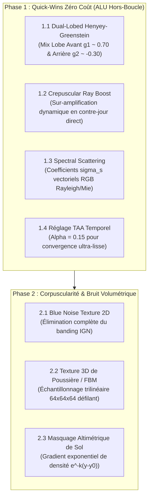

# Spécification Technique : Améliorations Cinématographiques de l'Éclairage Volumétrique (Phases 1 & 2)

**Date** : 26 Octobre 2026  
**Auteur** : Antigravity & GLM Review Analysis  
**Statut** : 🚀 Phase 1 en cours d'implémentation / Phase 2 planifiée  
**Fichiers concernés** :
- `shaders/postfx/volumetric_raymarch_directional.frag`
- `src/rendering/volumetric.odin`
- `src/rendering/volumetric_presets.odin`
- `src/core/session/session.odin`
- `src/app/session.odin`
- `src/gui/gui_volumetric.odin`
- `tests/test_session.odin`

---

## 1. Vision & Objectifs Visuels

L'éclairage volumétrique directionnel actuel produit des rayons lumineux physiquement corrects mais basés sur un **milieu homogène à fonction de phase Henyey-Greenstein à lobe unique**.
L'objectif est d'atteindre le rendu atmosphérique des moteurs de jeu AAA contemporains (*Unreal Engine 5*, *Decima*, *Frostbite*) :
- **Atmosphère texturée & poussière vivante** : Présence de micro-particules en suspension et volutes de brume hétérogènes.
- **Réalisme optique & contre-jour** : Halo rétro-diffusé naturel autour de la source lumineuse et éblouissement cinématographique face au soleil.
- **Diffraction chromatique** : Séparation spectrale naturelle (diffusion Rayleigh bleutée en ciel ouvert, absorption chaude/rougeâtre au ras du sol).
- **Zéro régression de performance** : Capitaliser sur l'accumulation temporelle TAA existante pour ne pas alourdir la boucle de marche GPU.

---

## 2. Feuille de Route en 2 Phases

---

## 3. Détail de la Phase 1 (Implémentation Immédiate)

Chaque fonctionnalité de la Phase 1 est conçue pour être **individuellement commutable (toggle on/off)** dans l'interface Dear ImGui et **100% persistée dans la session JSON** afin de pouvoir isoler et doser son impact artistique.

### 1.1 Fonction de Phase Double Lobe (Dual-Lobed Henyey-Greenstein)
- **Modèle physique** :
  $$P(\theta) = (1 - w) \cdot P_{\text{HG}}(\theta, g_2) + w \cdot P_{\text{HG}}(\theta, g_1)$$
  avec $g_1 \in [0.0, 0.90]$ (lobe avant), $g_2 \in [-0.99, 0.0]$ (lobe arrière) et $w \in [0.0, 1.0]$.
- **Intérêt visuel** : Génère un halo doux réaliste visible même lorsque la source lumineuse est zénithale ou latérale.
- **Coût GPU** : **0.00 ms** (calculé une seule fois par fragment hors boucle raymarch pour la lumière directionnelle).

### 1.2 Sur-amplification en Contre-jour (Crepuscular Ray Boost)
- **Modèle physique** :
  $$B = 1.0 + \text{smoothstep}(\text{threshold}, 1.0, \cos\theta) \cdot \text{strength}$$
- **Intérêt visuel** : Émule l'éblouissement optique cinématique caractéristique des films lorsque l'observateur regarde directement vers le soleil.
- **Coût GPU** : **0.00 ms** (facteur multiplicateur calculé hors boucle).

### 1.3 Diffusion Chromatique Spectrale ($\sigma_s$ RGB)
- **Modèle physique** :
  Vectorisation du coefficient de diffusion $\vec{\sigma}_s = (\sigma_{s,R}, \sigma_{s,G}, \sigma_{s,B})$ avec pondération par défaut $(1.20, 1.00, 0.85)$.
- **Intérêt visuel** : Teinte dorée chaude aux rayons proches du sol et composante bleue atmosphérique en altitude.
- **Coût GPU** : **0.00 ms** (registres vectoriels SIMD natifs du GPU).

### 1.4 Calibrage Fin de l'Accumulation Temporelle TAA
- **Modèle** : Réduction du poids de la frame courante `taa_alpha` de $0.20$ à $0.15$.
- **Intérêt visuel** : Permet au filtre TAA existant d'accumuler davantage d'historique (4 à 8 frames), gommant le bruit d'échantillonnage et autorisant un step count réduit sans aucun aliasing.

---

## 4. Spécification de la Phase 2 (Planifiée)

1. **Jitter Blue Noise 2D** : Remplacement de l'IGN mathématique par une texture 2D tileable 64x64 pour éliminer les artéfacts diagonaux et accélérer la convergence temporelle.
2. **Texture Volumétrique 3D (64³)** : Bruit de Worley/Perlin précalculé ou curl noise généré au démarrage pour moduler localement la densité sans écrouler le taux de rafraîchissement.
3. **Plafond & Gradient Altimétrique** : Atténuation exponentielle naturelle vers le ciel pour simuler la couche limite planétaire.
