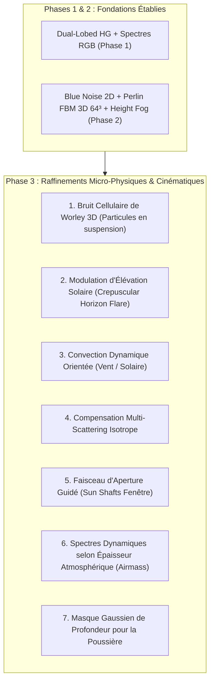

# 🌌 Éclairage Volumétrique Avancé — Analyse & Projections Architecturales (Phase 3)

**Date d'évaluation** : 27 Octobre 2026  
**Auteur** : Antigravity Engine Architecture Team & GLM Expert Review  
**Cible moteur** : `suckless-odin` (OpenGL 4.5 Core, Data-Oriented Design, SIMD AVX2, Hot-Reloadable ImGui)  
**Document parent** : [`2026-10-26_volumetric_lighting_cinematic_improvements_roadmap.md`](2026-10-26_volumetric_lighting_cinematic_improvements_roadmap.md)  

---

## 1. Contexte & Synthèse des Acquis (Phases 1 & 2)

Suite à la mise en œuvre réussie des **Quick-Wins P0** (-21.4% de charge sur le raymarch, 140+ FPS uncapped), de la **Phase 1** (Dual-Lobed Henyey-Greenstein, Crepuscular Boost, Spectres RGB) et de la **Phase 2** (Jitter Blue Noise 64x64 Void-and-Cluster, Texture FBM 3D $64^3$ $256\,\text{KB}$, Gradient barométrique de sol), l'éclairage volumétrique du moteur est passé d'un modèle homogène synthétique à un milieu hétérogène immersif.

Ce document consigne, analyse et projette les **7 propositions majeures d'évolutions fonctionnelles** formulées lors de la revue d'architecture par l'agent GLM, en confrontant la théorie physique aux impératifs d'architecture temps réel de `suckless-odin` :
* Zero runtime allocation (*ZRA*).
* Zero performance degradation sur iGPU / GPUs modestes (Iris Xe, Steam Deck).
* Parité stricte 100% Persistance JSON & Fuzzy Search ImGui avec boutons `Reset`.



---

## 2. Analyse Approfondie des 7 Propositions

### 2.1. Bruit Cellulaire de Worley 3D ($64^3$) pour Particules Discrètes

#### La proposition GLM
Remplacer ou combiner le bruit de Perlin par du bruit cellulaire de Worley (*Voronoi distance metrics*, Worley 1996). Alors que Perlin crée des "plumes" vaporeuses lisses continues, Worley génère des motifs nodaux discrets ressemblant exactement à des grains de poussière illuminés en suspension.

#### Analyse critique locale
* **Visuel** : Très supérieur pour l'effet "poussière dans un rayon de soleil" dans les intérieurs sombres (garage, cathédrale).
* **Piège potentiel** : Un Worley pur peut créer des discontinuités de haute fréquence aliassées lors du raymarching à faible pas ($N=16$).
* **Recommandation technique** : Conserver une texture $64^3$ `GL_RGBA8` combinée :
  * Canal **R** : Perlin FBM basse fréquence (macro-turbulences).
  * Canal **G** : Worley FBM moyenne fréquence (cellules).
  * Canal **B** : Worley haute fréquence (micro-grains).
  * Échantillonnage unifié : 1 seul fetch trilinéaire hardware `texture(u_dust_tex3d, uvw)` pour les 3 métriques !

#### Projection dans `suckless-odin`
* **Génération CPU au boot** : Étendre [`src/rendering/dust_noise.odin`](file:///home/latty/Prog/__PERSO__/suckless-odin/src/rendering/dust_noise.odin) pour précalculer une grille $64^3$ périodique toroïdale combinée en ~12 ms au lancement.
* **VRAM** : $64 \times 64 \times 64 \times 4\,\text{octets} = 1\,\text{MB}$ (totalement négligeable).
* **Shader** : `density_mod = mix(perlin_sample, worley_sample, u_dust_type)`.

---

### 2.2. Modulation d'Élévation Solaire (Crepuscular Horizon Flare)

#### La proposition GLM
Le sur-boost de contre-jour (*Crepuscular Boost*) est spectaculaire quand le soleil est rasant à l'horizon (effets dorés cinematographiques), mais s'avère artificiellement violent quand le soleil est au zénith ($\theta_{\text{elevation}} > 60^\circ$). Moduler l'intensité par l'élévation :
$$\text{boost}_{\text{effective}} = \text{boost} \cdot (1.0 - \text{smoothstep}(45^\circ, 85^\circ, \theta_{\text{elevation}}))$$

#### Analyse critique locale
* **Pertinence** : 100% aligné avec la physique optique. À l'horizon, la couche d'air traversée est 38 fois plus dense (effet Airmass), saturant la rétrodiffusion avant.
* **Coût GPU** : **0.00 ms** (calcul scalaire évalué sur CPU en Odin avant l'upload d'uniforms ou une seule fois par fragment dans le vertex/fragment shader hors boucle).

#### Projection dans `suckless-odin`
* **Localisation** : Calculé directement dans [`src/rendering/volumetric.odin`](file:///home/latty/Prog/__PERSO__/suckless-odin/src/rendering/volumetric.odin#L820) à partir de `sun_shadow.detection.elevation`.
* **Contrôles ImGui** : Toggle `Auto Horizon Fade##vol` avec slider de transition angulaire.

---

### 2.3. Convection Dynamique Orientée (Vecteur Vent / Ascendance Solaire)

#### La proposition GLM
Remplacer le vecteur de dérive temporel fixe `vec3(0.08, 0.04, 0.06)` par une direction dérivée du vecteur de vent ambiant ou de la direction solaire (mouvement ascendant par convection thermique générée par la chaleur des photons).

#### Analyse critique locale
* **Dynamisme** : Donne vie à la scène lors de rotations solaires interactives via ImGuizmo.
* **Simplicité** : Évite d'ajouter une simulation de particules physique complète tout en donnant l'illusion parfaite d'une physique de fluides.

#### Projection dans `suckless-odin`
* **Architecture** : Passer un uniform `uniform vec3 u_dust_drift_dir` injecté dans [`volumetric_render`](file:///home/latty/Prog/__PERSO__/suckless-odin/src/rendering/volumetric.odin#L700).
* **Modes réglables** :
  1. *Manual Direction* (Euler yaw/pitch).
  2. *Solar Convection* (`normalize(vec3(sun_dir.x * 0.2, 1.0, sun_dir.z * 0.2))`).
  3. *Camera Relative* (la poussière flotte doucement autour du spectateur).

---

### 2.4. Compensation d'Énergie par Multi-Scattering Isotrope

#### La proposition GLM
La fonction de phase de Henyey-Greenstein ($P_{\text{HG}}$) mono ou double lobe ne modélise que la diffusion simple (*Single Scattering*). Elle perd 15% à 25% de l'énergie lumineuse diffractée par diffusion multiple entre particules. Ajouter une composante isotrope d'albédo résiduel :
$$P_{\text{compensated}}(\theta) = \text{mix}(P_{\text{HG}}(\theta), P_{\text{HG}}(\theta) + \frac{1}{4\pi} \cdot \alpha_{\text{MS}}, w_{\text{MS}})$$

#### Analyse critique locale
* **Rendu** : Élimine l'aspect "trop sombre" des volumes vus à angle droit ($90^\circ$) du soleil sans forcer artificiellement le `scattering_coeff`.
* **Coût ALU** : 2 instructions FMA hors-boucle. **0 cycle dans la boucle interne**.

#### Projection dans `suckless-odin`
* **Paramètres** :
  * `multi_scatter_enabled: bool` (`Session_State`).
  * `multi_scatter_amount: f32` ($[0.0, 1.0]$, défaut $0.25$, Reset).
* **Parité GUI** : Intégration dans le tracé du graphe de phase analytique ImGui dans `draw_tab_volumetric`.

---

### 2.5. Faisceau d'Aperture Guidé (Sun Shafts Fenêtre / Portique)

#### La proposition GLM
Le module de détection solaire du moteur (`src/scene/sun_detection.odin`) identifie déjà la présence d'ouvertures (`is_aperture`, `peak_sky_dir`). Augmenter sélectivement le `scattering_coeff` pour les points d'échantillonnage situés à l'intérieur du cône passant par l'ouverture détectée.

#### Analyse critique locale
* **Faisabilité** : Très esthétique pour les scènes d'intérieur comme `abandoned_garage` et `small_cathedral`.
* **Contrainte d'implémentation** : Nécessite un test analytique cône-point ou boîte-point dans la boucle de raymarch.
  * Si 16 pas de marche : 16 tests de distance point-cône = ~35 ALU supplémentaires par fragment.
* **Alternative performante** : Évaluer l'atténuation cône une seule fois sur le rayon caméra projeté ou borner le raymarch entre $t_{\text{near\_cone}}$ et $t_{\text{far\_cone}}$.

#### Projection dans `suckless-odin`
* **Seam d'intégration** : Injecter les métadonnées d'`env_metadata_cache.odin` (`aperture_center`, `aperture_radius`, `aperture_dir`) directement dans `Scene_State` et le shader volumétrique.

---

### 2.6. Spectres Dynamiques selon Épaisseur Atmosphérique (Airmass Table)

#### La proposition GLM
Au lieu d'utiliser des coefficients RGB fixes `vec3(1.20, 1.00, 0.85)`, faire dériver le triplet spectral de la hauteur angulaire du soleil selon l'approximation de Kasten-Young de la masse d'air optique relative :
$$X(\gamma) = \frac{1}{\sin\gamma + 0.50572 \cdot (\gamma + 6.07995^\circ)^{-1.6364}}$$

#### Analyse critique locale
* **Réalisme** : Produit automatiquement la transition continue entre :
  * Midi : diffusion bleue prédominante (ciel d'azur Rayleigh).
  * Couchant : diffusion rouge/orange profonde (extinction du bleu, rais d'or).
* **Coût** : Évalué sur CPU une fois par frame dans `scene_update()`. **0 coût GPU**.

#### Projection dans `suckless-odin`
* **Architecture** : Remplacer ou moduler `vr.params.spectral_coefficients` par une fonction pure `volumetric_compute_airmass_spectrum(elevation: f32) -> mt.Vec3`.
* **Contrôles** : Mode `Spectrum: Manual RGB / Physically Dynamic Airmass`.

---

### 2.7. Masque Gaussien de Profondeur pour la Poussière (Depth Window Mask)

#### La proposition GLM
Les particules de poussière en suspension ne sont visuellement identifiables par l'œil humain qu'à une plage de distance intermédiaire (typiquement entre 1 et 15 mètres). Trop près de l'objectif, elles créent un clignotement désagréable ; trop loin, elles bavent en basse résolution. Appliquer une fenêtre gaussienne :
$$\text{mask}(t) = \exp\left(-\left(\frac{t - t_{\text{focus}}}{w}\right)^2\right)$$

#### Analyse critique locale
* **Confort visuel** : Élimine les artéfacts de "grosses taches floues" collées à la caméra lors des mouvements brusques.
* **Coût** : 1 instruction `exp()` scalaire par pas, ou approximation quadratique polynomiale $1 - u^2$ sans division ni exponentielle.

#### Projection dans `suckless-odin`
* **Optimisation polynomiale** :
  ```glsl
  float d_rel = clamp((sample_dist - u_dust_near) / (u_dust_far - u_dust_near), 0.0, 1.0);
  float depth_mask = d_rel * (1.0 - d_rel) * 4.0; // Cloche 0 -> 1 -> 0
  density_mod *= mix(1.0, 0.3 + dust_sample * 1.7 * depth_mask, u_dust_intensity);
  ```

---

## 3. Matrice de Priorisation & Roadmap Phase 3

| ID | Proposition | Impact Visuel | Coût GPU | Complexité Odin / GLSL | Priorité Retenue |
| :---: | :--- | :---: | :---: | :---: | :---: |
| **3.1** | **Worley Noise 3D $64^3$ (RGB Texture)** | ⭐⭐⭐⭐⭐ | $< 0.10\,\text{ms}$ | Moyenne (Texture Generator CPU) | **P1 (Immédiat)** |
| **3.2** | **Crepuscular Horizon Fade** | ⭐⭐⭐⭐ | $0.00\,\text{ms}$ | Très faible (Formule CPU) | **P1 (Immédiat)** |
| **3.3** | **Masque Gaussien / Cloche de Distance** | ⭐⭐⭐⭐ | $< 0.05\,\text{ms}$ | Faible (2 ALU shader) | **P1 (Immédiat)** |
| **3.4** | **Convection Dynamique Solaire** | ⭐⭐⭐ | $0.00\,\text{ms}$ | Faible (Passage d'uniform) | **P2** |
| **3.5** | **Multi-Scattering Isotrope** | ⭐⭐⭐ | $0.00\,\text{ms}$ | Faible (Shader hors-boucle) | **P2** |
| **3.6** | **Spectres Dynamiques Airmass** | ⭐⭐⭐⭐ | $0.00\,\text{ms}$ | Moyenne (Formule Kasten-Young) | **P2** |
| **3.7** | **Aperture Cones (Shafts Fenêtres)** | ⭐⭐⭐⭐⭐ | $0.20 - 0.40\,\text{ms}$ | Élevée (Math intersection 3D) | **P3 (R&D Spécifique)** |

---

## 4. Garanties de Conformité & Persistance pour la Phase 3

Toute implémentation future issue de cette feuille de route devra scrupuleusement respecter :
1. **Règle 100% Persistance** : Chaque paramètre de phase 3 aura son entrée dans `Session_State`, ses vérifications dans `check_persistence.py` et son test unitaire dédié.
2. **Tolérance Zéro Régression de Frame Time** : Le budget d'accumulation volumétrique sous résolution 1/2 ne doit en aucun cas dépasser **$0.75\,\text{ms}$** sur GPU dédié et **$1.40\,\text{ms}$** sur iGPU Iris Xe.
3. **Contrôles UI Homogènes** : Checkbox de débrayage individuel, curseurs bornés et bouton `Reset` systématique dans l'onglet Volumetric et dans la vue de recherche floue.
